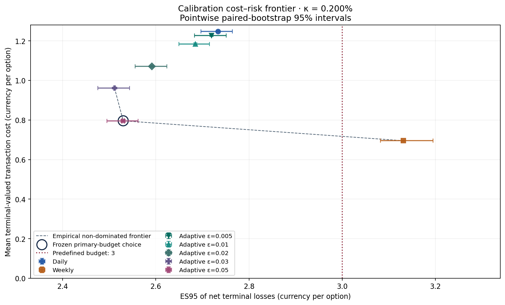
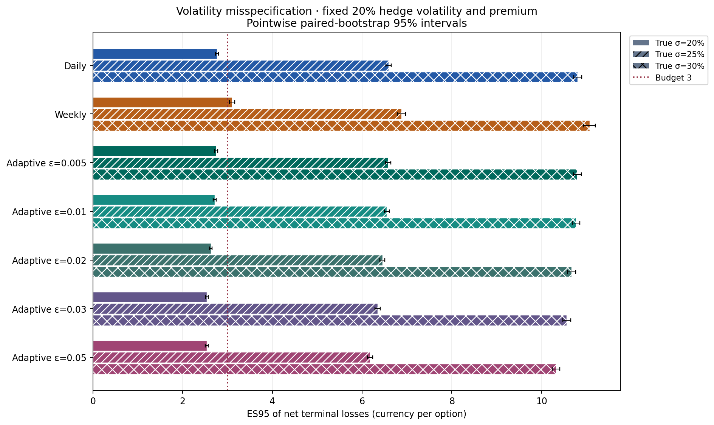

# Adaptive Delta Hedging under Transaction Costs and Risk Constraints

An academic Monte Carlo study of a hypothetical derivatives desk hedging a
short European call. Seven stock-rebalancing policies are compared using
self-financing accounting, proportional transaction costs and a terminal
Expected Shortfall (ES) constraint. Calibration and independent evaluation
separate policy selection from performance assessment. All scenarios are
synthetic; this is not a real bank engagement or a production trading system.

## Research question

**How can a derivatives desk select a delta-hedging strategy that minimises
expected transaction costs while satisfying a predefined tail-risk constraint?**

The finite-set objective is

$$\min_{\pi\in\mathcal A}\mathbb E[TC_T^{\mathrm{fv}}(\pi)]
\quad\text{subject to}\quad ES_{0.95}(-\Pi_T^{\mathrm{net}}(\pi))\le R_{\max}.$$

## Framework and policies

Exact geometric Brownian motion generates physical stock scenarios with drift
$\mu=0.05$. Risk-neutral Black-Scholes pricing and Delta use $r=0$ and model
volatility 20%. The baseline has $S_0=K=100$, $T=1$ year, true volatility 20%
and 252 trading intervals. The bank receives one premium, buys Delta shares,
and holds the remainder in an interest-bearing cash account:

$$B_i=B_{i-1}e^{r\Delta t}-(\phi_i-\phi_{i-1})S_i
-\kappa|\phi_i-\phi_{i-1}|S_i.$$

The stock holding is liquidated once at maturity and the call is cash-settled.
Opening, intermediate and closing stock trades all pay the proportional
half-spread. Terminal net P&L is cash after liquidation minus the call payoff.
Gross P&L uses identical trades without fees; their difference equals
terminal-valued transaction expenses.

- **Daily:** rebalance at each interior date.
- **Weekly:** rebalance every five trading intervals.
- **Adaptive:** rebalance to model Delta only when its distance from actual
  holdings strictly exceeds $\varepsilon$; test 0.005, 0.01, 0.02, 0.03 and 0.05.

Policies share exactly the same stock paths within each scenario. The initial
comparison uses 2,000 paths. Selection uses 20,000 calibration paths and a
separate 20,000-path evaluation sample, with 500 paired bootstrap resamples.
A fresh 50,000-path calculation and independent 1,000-resample baseline
intervals assess numerical precision without changing the selected policy.
All parameters and seeds are in [configs/study.json](configs/study.json) and
the experiment metadata.

## Main findings

At half-spread 0.002 and risk budget 3, calibration selects adaptive threshold
0.05. Independent evaluation gives:

| Policy | Mean transaction cost | Net P&L SD | ES95 of net losses |
|---|---:|---:|---:|
| Daily | 1.252041 | 0.603794 | 2.765311 |
| Weekly | 0.695477 | 0.996563 | 3.100370 |
| Adaptive 0.01 | 1.188401 | 0.612853 | 2.716822 |
| Adaptive 0.05 | 0.798113 | 0.754390 | 2.537173 |

Amounts are currency units per sold call. The selected policy's ES95 interval
is [2.506753, 2.569162] in the main evaluation. Weekly costs less but exceeds
budget 3. No candidate is calibration-feasible at budgets 1 or 2 for this fee
rate. At smaller positive spreads, weekly can instead be the cheapest feasible
policy. Adaptive hedging is therefore not universally optimal.

Threshold 0.05 is at the upper boundary of the tested grid: the selection is
an optimum within seven policies only. On 50,000 fresh paths its ES95 is
2.525674, interval [2.504552, 2.545226]. With true volatility raised to 25%
while hedge volatility and premium remain at 20%, its ES95 rises to 6.179234,
interval [6.119002, 6.235605], and the original risk constraint fails.





The [methodology](docs/methodology.md) derives pricing, Greeks and the ledger,
including numerical examples and empirical ES with fractional tail weights.
The [results and discussion](docs/results_and_discussion.md) cover convergence,
paired comparisons, fee sensitivity, funding versus hedge-model error and
remaining uncertainty. A printable PDF synthesis can be generated locally
with `python validation/build_report.py`; generated report PDF and TeX files
are excluded from version control.

## Reproduce

Run from this repository root with Python 3.11 or later (checked with Python
3.12.6). Create and activate a virtual environment if desired, then:

```shell
python -m pip install -r requirements.txt
python -m pytest -q
python experiments/01_model_validation.py
python experiments/02_baseline_hedging.py
python experiments/03_cost_risk_optimisation.py
python experiments/04_volatility_stress_test.py
python validation/run_validation.py
python validation/supplementary_checks.py
python validation/build_report.py --documents-only
```

Run selection before the stress experiment: stress reads the saved frozen
decision and does not optimise again. Scripts accept `--help`; the first two
also accept individual financial parameters and path counts, while selection
loads the JSON configuration. Fixed seeds make runs deterministic in the
recorded environment; library/platform changes can cause small floating-point
differences. Configuration and source hashes are saved with experiment output.

`python validation/run_validation.py --reproduce` additionally runs the full
tests and four experiments in a temporary directory and compares the main
numeric tables with the saved results. Temporary duplicate experiment outputs
are discarded. This is a longer alternative to the individual commands above.

To rebuild the PDF, install Pandoc and a LaTeX distribution providing
`pdflatex`, then run:

```shell
python validation/build_report.py
```

Optional visual previews use `python validation/build_report.py --render` and
require Poppler (`pdfinfo`, `pdftotext`, `pdftoppm`) and Pillow. Python numerical
dependencies are listed in [requirements.txt](requirements.txt).

## Repository and result data

- `src/`: pricing, simulation, self-financing hedging, metrics and policy selection.
- `experiments/`: four reproducible studies; calculations are separate from plotting.
- `tests/`: analytical, statistical, ledger and command-line regression tests.
- `validation/`: independent financial/statistical calculations and report generation.
- `configs/`: fixed benchmark parameters and random seeds.
- `results/`: CSV tables, compressed path/bootstrapping arrays, metadata and figures;
  see the [data guide](results/README.md).
- `docs/`: methodology, results and bibliography; an optional report is generated locally.

## Limitations

Results depend on constant-volatility GBM, hypothetical spreads, fractional
shares and unrestricted borrowing/lending. There is no empirical calibration,
jump risk, stochastic volatility, market impact, margin or liquidity model.
Pointwise bootstrap intervals are not simultaneous certificates for the
searched grid. Near-budget decisions remain sensitive to finite-sample and
bootstrap endpoint uncertainty. Baseline feasibility does not imply stress
robustness, and significance within this model does not establish real-market
performance. Extreme numerical inputs outside the benchmark have documented
API limitations. Full qualifications are retained in the results discussion.

## References

The following public resources were consulted for the discussion of hedging
frequency and transaction costs, and for the definition of Expected Shortfall:

- [Artur Sepp (2017), *How to optimize volatility trading and delta-hedging
  strategies under the discrete hedging with transaction costs*](https://artursepp.com/2017/05/01/how-to-optimize-volatility-trading-and-delta-hedging-strategies-under-the-discrete-hedging-with-transaction-costs/):
  the trade-off between hedging frequency, transaction costs and residual risk.
- [Carlo Acerbi and Dirk Tasche (2002), *On the coherence of Expected
  Shortfall*](https://arxiv.org/abs/cond-mat/0104295):
  the definition of Expected Shortfall, including empirical distributions.

## Academic background

This project originated as an academic coursework project at Zhejiang
University. I subsequently revisited and substantially reworked the study,
correcting the portfolio accounting, rebuilding the simulation engine, and
extending the analysis to transaction costs and tail-risk constraints.

## Critical review with Codex

OpenAI Codex was used to critically review the initial project, identify accounting and methodological errors, and assist with code revisions, tests, documentation.
