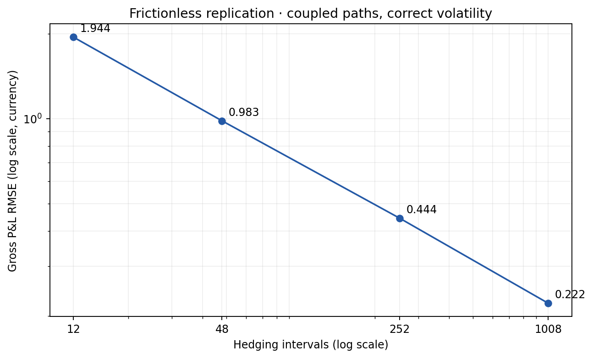
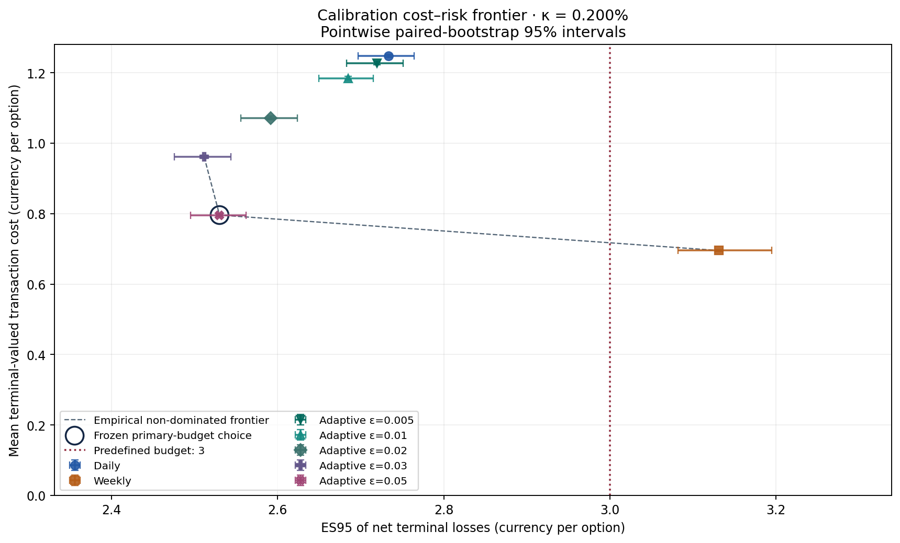
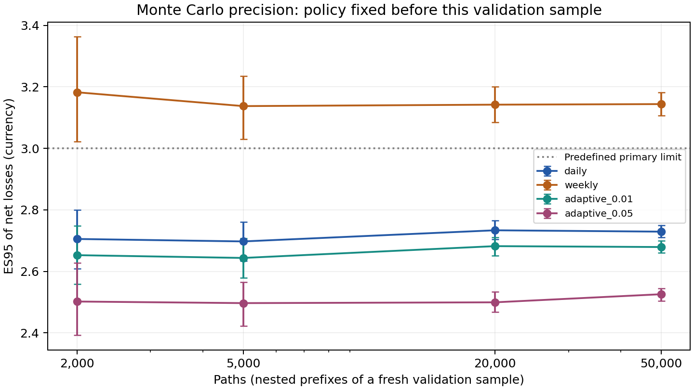
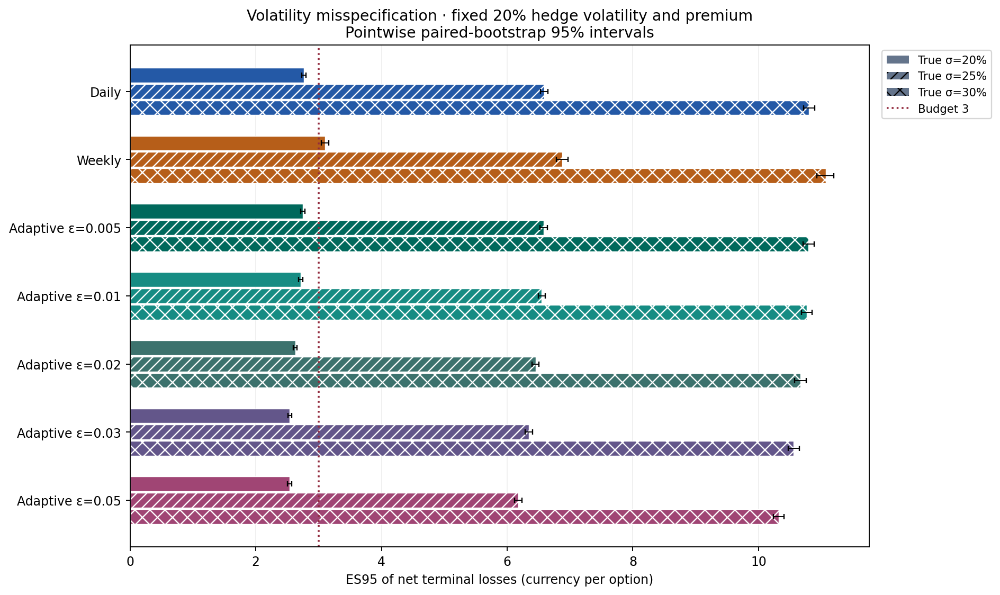

# Numerical validation

All results below use the current self-financing implementation, per sold call.
Historical coursework results are not reused in these calculations.
The complete parameter and seed definitions are in [methodology.md](methodology.md)
and [configs/study.json](../configs/study.json). The baseline comparison uses
2,000 physical paths; policy selection uses 20,000 calibration paths and
20,000 independent evaluation paths. A separate 50,000-path sample evaluates
the frozen policies without selecting a new threshold.

## Analytical pricing and frictionless convergence

The risk-neutral pricing check uses 2,000 exact terminal draws with seed
314159. Scenario simulations for hedging instead use the physical drift.

@@PRICING_TABLE@@

The analytical price lies within this run's 95% normal-CLT interval. A valid
95% interval need not contain the analytical price in every finite sample;
the regression test uses a wider statistical tolerance. This validates pricing
under the stated model, not a forecast of physical expected payoffs.

A coupled frictionless experiment uses 2,000 risk-neutral paths with seed
271828. Meshes are subsamples of the same 1,008-step Brownian paths, with
correct model volatility and zero costs.

@@MESH_TABLE@@

The paired mean-square-error reduction from 12 to 1,008 intervals is 3.731212,
with standard error 0.161478 and 95% interval [3.414721, 4.047702]. This supports
overall convergence; no strict sample-by-sample monotonicity is assumed.

## Financial accounting and numerical consistency

Deterministic ledger tests check cash interest, no-trade intervals, execution
conservation, initial and terminal fees, payoff settlement and the absence of
a maturity Delta trade. Independent discounted-gain checks cover all seven
policies at rates 0, 0.03 and -0.02, with 1,000 paths per case (seed 108).
The maximum absolute accounting residual is **@@ACCOUNT_RESIDUAL@@** currency
units. Gross minus net P&L equals terminal-valued fees path by path; costs and
payoff are each charged once. A failed accounting check blocks interpretation
of the results.

Independent sorted-loss calculations reproduce ES for every fee-policy case
within floating-point precision. Numerical tables and saved path-result arrays
are compared when reproducing the four experiments. Current execution evidence
is in `results/validation/reproducibility.json` and
`results/validation/tables/reproduction_comparison.csv`.

An additional risk-neutral financial check uses 20,000 paths, 64 intervals,
seed 9876, rate 0.04, true volatility 0.25 and model volatility 0.20. Under
the risk-neutral drift, a predictable bounded stock hedge has zero expected
discounted trading gain. Expected gross terminal P&L therefore equals

$$[C_{BS}(0.20)-C_{BS}(0.25)]e^{0.04}=-1.990023,$$

irrespective of the chosen hedge policy. The observed means lie within about
1.62 standard errors of this value.

@@QCHECK_TABLE@@

# Simulation results

## Initial 2,000-path hedging comparison

Daily, weekly and adaptive threshold 0.01 reuse the same physical paths
(seed 42) in both fee scenarios. The premium is the 20% Black-Scholes price.
Gross P&L is a fee-free shadow with identical trades; it is not obtained by
adding average fees to every net outcome.

@@INITIAL_TABLE@@

At zero costs, daily has slightly lower replication RMSE than adaptive 0.01,
while weekly has much higher dispersion. At a 0.2% half-spread, weekly saves
fees and has lower net MAE/RMSE than the two frequent policies in this sample.
That does not establish its tail-risk feasibility. The adaptive policy removes
about 40% of daily executed tickets but saves only about 5.1% of fees: proportional
costs depend on notional, and skipped small changes accumulate into larger trades.

## Independent 20,000-path baseline evaluation

At half-spread 0.002, the seven policies give the following evaluation results.
P&L SD is the sample standard deviation, not the standard error of its mean.
RMSE measures distance from zero P&L, including the mean funding shortfall.

@@BASELINE_TABLE@@

The premium includes no cost loading, explaining much of the negative mean
net P&L. Fees vary across paths and correlate with replication outcomes, so
they also affect dispersion. Daily remains more accurate in gross RMSE than
the wider adaptive bands. Lower net RMSE is not equivalent to lower gross
replication error or to minimum expected cost subject to ES.

@@CI_TABLE@@

These intervals use 1,000 independent paired bootstrap resamples, seed 94001.
The main experiment separately stores 500-resample intervals (seed 732).
Their endpoints differ slightly because of bootstrap simulation error; they
estimate the same fixed-policy quantities.

@@TRADE_TABLE@@

Opening, interior and closing tickets are distinct. Zero share changes do not
count as executions; normal-CDF saturation near expiry can reduce executed
counts below eligible calendar dates. Adaptive 0.05 cuts roughly 84% of tickets
and 36.3% of fees relative to daily, rather than reducing both proportionately.

## Paired comparisons and statistical interpretation

All policies share stock paths. The following contrasts resample each path
jointly across policies and report first minus second.

@@PAIR_TABLE@@

Daily minus adaptive 0.05 mean cost is 0.453928; the independent 1,000-resample
95% interval is [0.452344, 0.455614]. The main experiment's 500-resample interval
is [0.452279, 0.455614]. Weekly is cheaper than adaptive 0.05 but has higher ES.
Adaptive 0.03 and 0.05 have nearly equal ES: their interval contains zero.
The study therefore does not establish which of these two has lower population
ES, despite a clear cost difference.

Holm correction across the six specified mean-P&L contrasts retains their
differences at 5%; the ES intervals remain pointwise and are not converted
into simultaneous significance claims. Some stored tiny p-values underflow
to zero numerically; they do not mean an exact zero probability.

# Cost-constrained policy selection

## Calibration and independent evaluation

Selection minimises calibration mean terminal-valued fees among policies
whose point ES estimate meets the chosen budget. Calibration choices are
saved before independent evaluation paths are generated. Ties use lower ES,
then lexical policy ID. Evaluation and stress never reselect a policy.

At half-spread 0.002, the point-estimate calibration frontier contains adaptive
0.03, adaptive 0.05 and weekly. The selected threshold is **0.05**, with
calibration cost 0.796018 and ES 2.530101 under budget 3. It lies at the **upper
boundary of the tested threshold grid**, so it is only a finite-set optimum.

@@BUDGET_TABLE@@

The selected evaluation ES is 2.537173 with the main experiment's 95% interval
[2.506753, 2.569162], leaving point-estimate headroom 0.462827. No calibration
candidate meets budgets 1 or 2 at the 0.2% half-spread. This is infeasibility
within the seven tested policies, not proof that no admissible hedge could
meet those limits.

## Transaction-cost sensitivity

These policies depend on stock prices and model Delta, not cash balances or
fees. On a fixed trade sequence, fees scale exactly with the proportional
rate. This identity includes opening, interior and closing expenses and their
financing; it is tested against full direct ledger simulations.

@@SENSITIVITY_TABLE@@

At zero fees all cost objectives tie, and the lower-ES tie break reports daily.
At small positive spreads weekly can meet budget 3 and is cheapest. At 0.005
no candidate is calibration-feasible. Thus adaptive hedging is not universally
optimal even within this study's model and candidate set.

## Sample-size convergence and a near-boundary case

A fresh independent sample uses seed 862202. The policies remain frozen, and
the samples below are nested prefixes, not independent replications at each
size. Bootstrap replicates number 500, with seed 94002 plus the path count.

@@PATH_COUNT_TABLE@@

The 50,000-path adaptive 0.05 result supports baseline budget-3 feasibility
within the model. Nearby threshold rankings remain uncertain: the fresh
50,000-path ES for adaptive 0.03 is 2.516631, compared with 2.525674 for 0.05.
The new sample is not used to replace the calibration selection.

At half-spread 0.001 and budget 2, the original independent evaluation of frozen
adaptive 0.05 gives ES 1.974831 and interval [1.947923, 2.004507]. Point feasibility
holds, but the upper-endpoint diagnostic does not. On 50,000 fresh paths the
estimate is 1.969963 with interval [1.948600, 1.990360] (1,000 resamples,
seed 94004), strengthening evidence for this setting under the model. This
does not retroactively remove uncertainty from the original sample.

With only 500 bootstrap draws, extreme percentile endpoints have additional
simulation noise. A secondary resampling diagnostic (3,000 repetitions,
seed 94006) yields the following ranges for the reported upper endpoints;
these ranges concern bootstrap numerical precision, not new population-ES
confidence intervals.

@@ENDPOINT_TABLE@@

# Sensitivity and robustness

## Frozen-policy volatility stress

True volatility increases from 20% to 25% and 30%, while the model Delta and
premium remain at 20%. Scenarios share Gaussian shocks, enabling paired
comparisons, and remain independent of calibration. All figures use the
original frozen policies; there is no stress-specific optimisation.

@@STRESS_TABLE@@

Adaptive 0.05 ES rises to 6.179234 at 25% true volatility, interval
[6.119002, 6.235605], and to 10.319762 at 30%, interval [10.233634, 10.403395].
It fails its original budget 3 by a large margin. Weekly also deteriorates;
fixed trading dates do not remove the model-volatility dependence of holdings.

Paired changes in relative ES gaps are listed below. The common premium shift
cancels in pairwise ES gaps. The contrasts establish policy/model interactions
within these scenarios, but do not isolate a pure causal effect of trigger
timing, since holdings and trading rules also differ.

@@INTERACTION_TABLE@@

## Separating funding and hedge-volatility mismatch

At true volatility 25%, the 20% premium is 7.965567 versus a fair scenario
Black-Scholes premium of 9.947645. Adding the difference 1.982078 to initial
funding translates terminal P&L and ES at zero rate, leaving dispersion and
trading unchanged. For adaptive 0.05 this reduces ES from 6.179234 to 4.197157,
which still exceeds budget 3. Underpricing alone therefore does not account
for the full stress failure.

A controlled diagnostic uses identical 25% paths (seed 202612) and the same
fair premium, changing only the hedge-model volatility from 20% to 25%.
The policy forms and thresholds remain fixed.

@@CONTROL_TABLE@@

For adaptive 0.05, correct-volatility hedging yields ES 2.923907, with interval
[2.879727, 2.968480]. The paired wrong-minus-correct ES difference is 1.273250,
interval [1.223002, 1.320652] (500 resamples, seed 94005). This is a conditional
hedge-model diagnostic, not a new optimum or an assumption that future
volatility is observable. Fair funding plus correct model Delta answers a
different question from the principal fixed-premium stress.

# Discussion and limitations

The results support expected-cost selection under an explicit terminal ES
constraint within a specified synthetic model. They do not establish a
universal advantage for adaptive hedging. Weekly can be cheapest and feasible
at lower spreads; daily improves gross replication at high frequency; wider
adaptive bands can save fees while respecting the baseline budget.

The following qualifications are material to interpretation:

- **Finite candidate set:** threshold 0.05 is a grid endpoint. No continuous
  optimisation or general optimal-control result is established.
- **Model conditionality:** constant-volatility GBM, fixed proportional
  half-spreads, fractional shares and unrestricted symmetric financing omit
  jumps, stochastic volatility, dividends, market impact, margin and liquidity
  effects. There is no empirical market calibration or out-of-market test.
- **Stress failure:** baseline feasibility does not transfer to volatility
  misspecification. The selected fixed policy fails the original ES budget.
- **Statistical uncertainty:** ES uses only the worst 5% of paths. Bootstrap
  intervals are pointwise, not simultaneous grid certificates, and calibration
  intervals do not remove selection effects. The independent evaluation and
  fresh fixed-policy sample reduce tuning optimism but do not prove market
  performance. Nested sample sizes are correlated.
- **Design provenance:** code ordering verifies calibration/evaluation
  separation, but mutable configuration files and the absence of an immutable
  version history cannot independently establish preregistration of earlier
  grids and budgets. No claim of tuning is inferred from that limitation.
- **Numerical domain:** extreme finite rates or underflowing volatility/time
  combinations can produce infinity or NaN despite passing input finiteness
  checks. The cost-rescaling helper trusts the supplied reference spread.
  These limitations are recorded in the supplementary diagnostics; the
  configured benchmark is unaffected. The implementation is not certified
  for arbitrary extreme inputs or production use.

## Conclusion

For the tested baseline, adaptive threshold 0.05 is the lowest estimated-cost
calibration-feasible member of seven policies under budget 3. Independent
evaluation and a fresh 50,000-path calculation support feasibility under the
assumed model. Higher true volatility breaks the same risk limit. Cost rate,
premium convention, model volatility, candidate grid and uncertainty all
matter to the decision; statistical evidence within GBM does not establish
real-market performance.

The financial framework, relation to the literature and full references are
in [methodology.md](methodology.md). This study originated as academic
coursework at Zhejiang University and was subsequently reimplemented and
extended.
